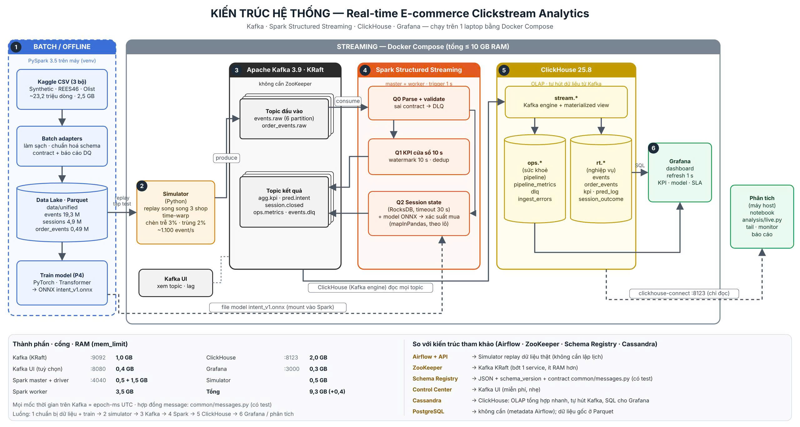

# Kiến trúc hệ thống — Real-time E-commerce Clickstream Analytics

> Ảnh được vẽ bằng `docs/draw_architecture.py` (SVG + PNG). Sửa toạ độ hoặc nhãn trong script rồi chạy lại:
> `python docs/draw_architecture.py`

## Luồng dữ liệu (theo số trên hình)

| # | Thành phần | Làm gì | Vào → Ra |
|---|---|---|---|
| 1 | **Batch / Offline** (PySpark 3.5, venv trên máy) | Làm sạch 3 bộ Kaggle, chuẩn hoá về schema chung, kiểm tra contract, train model | CSV → `data/unified` (Parquet) → `intent_v1.onnx` |
| 2 | **Simulator** (Python, container) | Phát lại tập test của từng shop theo đồng hồ thật (time-warp), cố ý chèn 3% event trễ và 2% event trùng | Parquet → `events.raw`, `order_events.raw` |
| 3 | **Kafka 3.9 KRaft** | Hàng đợi bền giữa các bước, giữ 24 h; 7 topic theo `common/messages.py` | — |
| 4 | **Spark Structured Streaming** | Micro-batch 1 s. Q0: kiểm tra contract (lỗi → DLQ). Q1: KPI cửa sổ 10 s (watermark, dedup). Q2: giữ state từng session, gọi model ONNX theo lô → xác suất mua | `events.raw` → `agg.kpi`, `pred.intent`, `session.closed`, `ops.metrics`, `events.dlq` |
| 5 | **ClickHouse 25.8** | Tự đọc mọi topic qua Kafka engine + materialized view; lưu `rt.*` (nghiệp vụ) và `ops.*` (sức khoẻ pipeline); 15 view sẵn cho dashboard | Kafka → bảng + view |
| 6 | **Grafana** | Dashboard refresh 1 s: KPI, funnel, model online (AUC), SLA giao hàng, độ trễ | SQL → biểu đồ |
| – | **Phân tích** (máy host) | `analysis/live.py` (tail, monitor, cảnh báo), notebook báo cáo | ClickHouse → pandas |

## Cổng và RAM (Docker Compose)

| Service | Cổng | RAM |
|---|---|---|
| Kafka (KRaft) | 9092 | 1,0 GB |
| Kafka UI (tuỳ chọn) | 8080 | 0,4 GB |
| Spark master + driver | 4040 (UI) | 0,5 + 1,5 GB |
| Spark worker | – | 3,5 GB |
| ClickHouse | 8123 (HTTP), 9000 | 2,0 GB |
| Grafana | 3000 | 0,3 GB |
| Simulator | – | 0,5 GB |
| **Tổng** | | **9,3 GB** (+0,4 nếu bật Kafka UI) |

## So với kiến trúc tham khảo (Airflow → Kafka → Spark → Cassandra)

| Tham khảo | Đồ án dùng | Lý do |
|---|---|---|
| Airflow + API | Simulator replay dữ liệu thật | Dữ liệu là lịch sử cần phát lại theo thời gian, không phải gọi API theo lịch |
| ZooKeeper | Kafka KRaft | Kafka 3.x không cần ZooKeeper: bớt 1 service và RAM |
| Schema Registry | JSON + `schema_version` + `common/messages.py` | Contract một nguồn, test tự kiểm khớp giữa simulator, Spark và ClickHouse |
| Control Center | Kafka UI | Miễn phí, nhẹ |
| Cassandra | ClickHouse | Dashboard cần tổng hợp (GROUP BY, quantile, AUC) nhanh và SQL cho Grafana; Cassandra mạnh ở ghi/đọc theo khoá, yếu ở tổng hợp |
| PostgreSQL | không cần | Chỉ là metadata của Airflow; dữ liệu gốc nằm ở Parquet |
